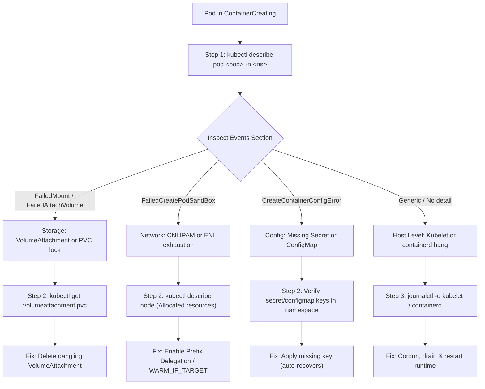

# Kubernetes Interview Questions: Pod Stuck in `ContainerCreating`

> **Question from Interviewer:**  
> *"How would you debug a pod stuck in `ContainerCreating` during deployment? What are your next 3 CLI commands?"*

---

## Part 1: How to Portray & Deliver in a Real-Time Interview

### The 15-Second Opening Anchor (The "Composure Pitch")

> 🗣️ **What to say directly to the interviewer:**  
> *"When a pod is stuck in `ContainerCreating`, my immediate mental model is that the Kubernetes control plane—the API server and scheduler—has already done its job. The pod has been assigned to a node. The failure is happening locally on that worker node where the Kubelet or the Container Runtime Interface (CRI) is unable to initialize the pod sandbox.*  
>  
> *In production, this almost always points to one of four areas: a persistent volume mount lock, CNI IP address exhaustion, a missing ConfigMap or Secret, or a failing admission webhook sidecar.  
>  
> *I follow a disciplined 3-command triage path to isolate the failure layer within 60 seconds without guessing."*

#### 🎯 Choice of Words & Seniority Signals
- **Use the phrase:** *"The control plane has succeeded; the fault is local to the node/CRI."*  
  *(Why: Shows the interviewer you fundamentally understand the Kubernetes state machine rather than seeing it as a black box.)*
- **Frame the 4 culprits immediately:** Volume, CNI, Secret/ConfigMap, Webhook.  
  *(Why: Demonstrates structured thinking before running a single command.)*
- **Avoid:** Blaming the application code or jumping straight into rebooting the node.

---

### Step 1: Inspect Pod Events & Lifecycle (The First CLI Command)

> 🗣️ **How to say it:**  
> *"My very first command is always `kubectl describe pod`. I don't guess. I immediately jump to the bottom `Events` section to let the Kubelet tell me where it's stuck."*

```bash
kubectl describe pod <pod-name> -n <namespace>
```

#### ⚡ Fast Revision Subpoints: What You are Looking For
- **`FailedAttachVolume` / `FailedMount`:**  
  *Signal:* EBS/cloud volume multi-attach error (volume is still locked to a dead node in another AZ, or PVC is `Pending`).
- **`CreateContainerConfigError`:**  
  *Signal:* A Secret or ConfigMap referenced in `envFrom` or `volumeMounts` does not exist or has a typo in its key.
- **`FailedCreatePodSandBox`:**  
  *Signal:* CNI plugin error (e.g., AWS VPC CNI ran out of secondary private IPs or ENIs on this node).
- **Mutating Webhook Failure:**  
  *Signal:* Istio sidecar or Vault injector webhook timed out or rejected the pod mutation.

---

### Step 2: Validate Cluster & Node Dependency State (The Second CLI Command)

> 🗣️ **How to say it:**  
> *"Depending on what `describe pod` exposes, my second command pivots directly to the underlying dependency. If it's a storage failure, I inspect the PVC and VolumeAttachment. If it's an IP allocation error, I inspect the node's allocated capacity."*

```bash
# Branch A: If storage/mount issue:
kubectl get pvc,pv -n <namespace>
kubectl get volumeattachment

# Branch B: If CNI / PodSandBox issue:
kubectl describe node <node-name> | grep -A 10 "Allocated resources:"
```

#### 🎯 Choice of Words & Seniority Signals
- **Say:** *"If the volume is locked with a Multi-Attach error, I check `kubectl get volumeattachment` to see if a dangling attachment is tied to an old terminated node."*
- **Say:** *"If it's IP exhaustion on AWS EKS, I check if the node reached its maximum pod limit based on its ENI density ceiling."*

---

### Step 3: Inspect Node Kubelet and CRI Logs Directly (The Third CLI Command)

> 🗣️ **How to say it:**  
> *"If `kubectl describe pod` returns generic API events like `FailedCreatePodSandBox` without granular details, the issue is happening below the Kubernetes API at the OS or CRI runtime level. My third action is to check the Kubelet or containerd systemd journal on the host."*

```bash
# Accessing via node shell or node-debugger pod:
journalctl -u kubelet -n 100 --no-pager
journalctl -u containerd -n 100 --no-pager
```

#### ⚡ Fast Revision Subpoints: What This Catches
- `containerd` hanging on an image layer decompression or unpack.
- Stale or corrupted mount directory under `/var/lib/kubelet/pods/<pod-uid>/volumes`.
- Local disk inode exhaustion or full filesystem on `/var/lib/containerd`.

---

### Step 4: Explain Your Remediation Action (The Closing Pitch)

> 🗣️ **How to conclude your answer:**  
> *"Once isolated, my remediation depends on the finding:  
> 1. If it's a stuck volume lock, I safely delete the dangling `VolumeAttachment` object once confirming the old node is dead.  
> 2. If it's IP exhaustion on AWS VPC CNI, I enable prefix delegation (`ENABLE_PREFIX_DELEGATION=true`) or adjust `WARM_IP_TARGET`.  
> 3. If it's a missing Secret, I patch the missing key—Kubelet automatically detects it and starts the container without deleting the pod.  
> 4. If the node runtime itself is deadlocked, I cordon and drain the node (`kubectl drain`) and roll the instance."*

---

## Part 2: Quick Revision Subpoints & Visual Diagrams

### 1-Minute Visual Triage Flowchart



---

### Interview Quick-Fire Cheat Sheet

| Symptom in `describe pod` | Layer at Fault | Fast CLI Diagnostic | Instant Remediation |
|:---|:---|:---|:---|
| `FailedAttachVolume` / `Multi-Attach` | Cloud Storage / CSI | `kubectl get volumeattachment` | Delete dangling attachment if node is dead |
| `no IP addresses available in network` | CNI / IPAM | `kubectl describe node <node>` | Enable VPC CNI Prefix Delegation |
| `CreateContainerConfigError` | Kubernetes API Object | `kubectl get secrets,cm -n <ns>` | Patch missing key; Kubelet auto-starts |
| Generic `FailedCreatePodSandBox` | Host OS / CRI | `journalctl -u containerd -n 50` | Restart CRI or cordon and drain node |
