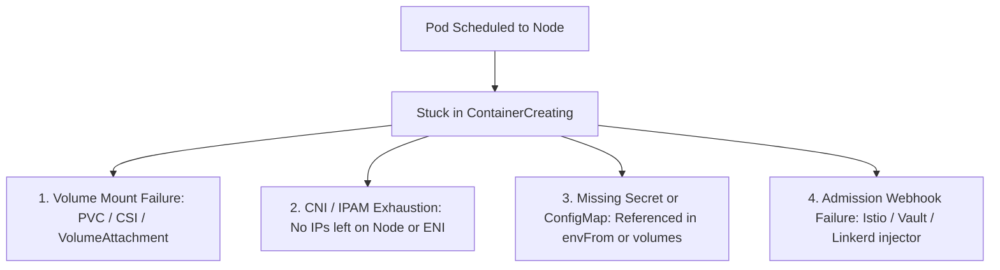
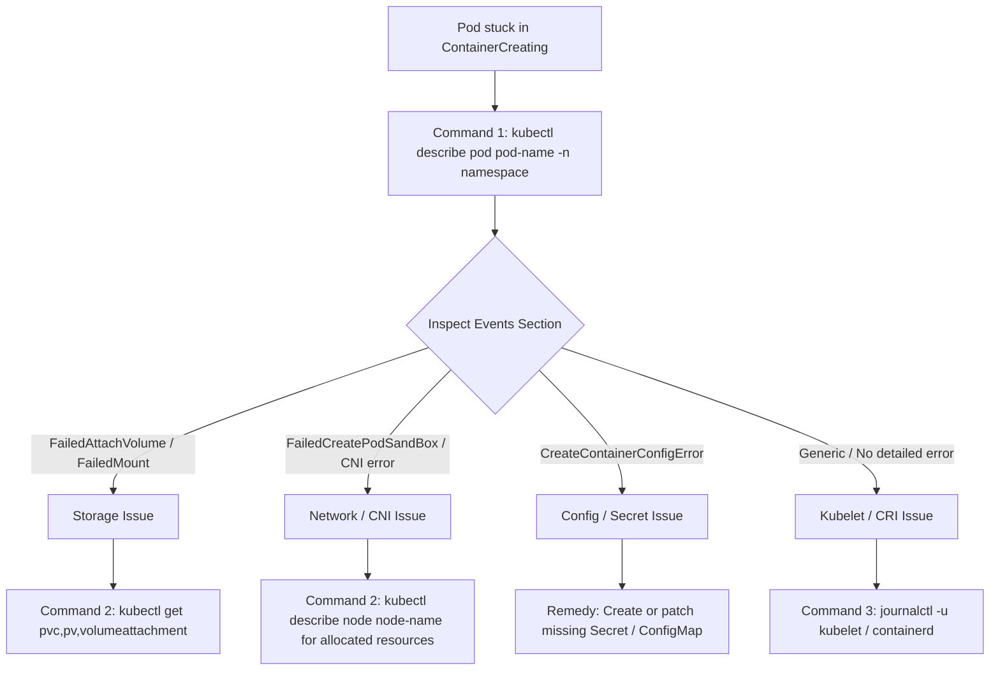

# Kubernetes Interview Questions

---

## Scenario: Debugging a Pod Stuck in `ContainerCreating`

> **Question:**  
> *How would you debug a pod stuck in `ContainerCreating` during deployment? What are your next 3 CLI commands?*

---

### Core Concept & Root Cause Landscape

When a pod is stuck in `ContainerCreating`, the **API server** and **Kubelet scheduler** have already succeeded in scheduling the pod to a node. The failure occurs locally on the worker node because the **Kubelet** or the **Container Runtime Interface (CRI)** cannot initialize the pod sandbox.

This failure almost always stems from one of four primary culprits:



---

### Triage Decision Workflow



---

### The 3 Core CLI Triage Commands

#### Command 1: Inspect Pod Lifecycle Events & Conditions

The fastest way to query the Kubelet's direct event stream and reason codes:

```bash
kubectl describe pod <pod-name> -n <namespace>
```

##### What to Check in the Output:

- **Volume Attach / Mount:**  
  Look for `FailedAttachVolume` or `FailedMount` (e.g., EBS Multi-Attach error because the volume is locked to an old node in another Availability Zone, or PVC is stuck in `Pending`).
- **ConfigMap / Secret Missing:**  
  Look for `CreateContainerConfigError` or warnings stating that an `envFrom` Secret or ConfigMap key does not exist.
- **CNI / IPAM Exhaustion:**  
  Look for `FailedCreatePodSandBox` with CNI plugin errors (e.g., AWS VPC CNI ran out of secondary private IPs/ENIs on that worker node).
- **Mutating Webhooks:**  
  Look for sidecar injection failures (e.g., Istio, Linkerd, or HashiCorp Vault injector failing to mutate pod spec).

---

#### Command 2: Inspect Cluster-Wide Node and Storage Dependencies

Depending on whether Command 1 pointed toward Volume, Network, or Node issues, verify the underlying dependency state:

```bash
# Case A: If persistent storage / volume issue
kubectl get pvc,pv -n <namespace>
kubectl describe pvc <pvc-name> -n <namespace>
kubectl get volumeattachment

# Case B: If CNI / PodSandBox / IP exhaustion issue
kubectl describe node <node-name> | grep -A 10 "Allocated resources:"
```

##### Why this matters:
- If persistent storage is failing, `kubectl describe pvc` reveals whether the `StorageClass` provisioner failed or the cloud block device is unreachable.
- If it is IP exhaustion, checking the node reveals whether the host has hit its pod or ENI allocation ceiling.

---

#### Command 3: Check Node Kubelet and Container Runtime Logs Directly

If the Kubernetes API events are generic (e.g., generic `FailedCreatePodSandBox` without granular details), the failure is happening at the CRI or OS kernel level:

```bash
# Connect to the node shell or run via node-debugger pod:
journalctl -u kubelet -n 100 --no-pager

# Check CRI runtime (containerd or CRI-O):
journalctl -u containerd -n 100 --no-pager
```

##### What this reveals:
- `containerd` hanging during image layer unpack or decompression.
- Stale mount points or corrupt `/var/lib/kubelet/pods/<pod-uid>/volumes` paths.
- Local disk inode or filesystem exhaustion on `/var/lib/docker` or `/var/lib/containerd`.

---

### Step-by-Step Remediation Playbook

| Root Cause | Diagnostic Indicator | Remediation Action |
|:---|:---|:---|
| **Volume Mount Locked** | `FailedAttachVolume`<br/>`Volume is already exclusively attached` | Check for dangling `VolumeAttachment` objects pointing to dead nodes:<br/>`kubectl get volumeattachment`<br/>Delete stale attachment if old node is terminated. |
| **CNI / IPAM Exhaustion** | `FailedCreatePodSandBox`<br/>`no IP addresses available in network` | Verify node IP capacity. For AWS VPC CNI, increase `WARM_IP_TARGET` or enable prefix delegation:<br/>`ENABLE_PREFIX_DELEGATION=true` |
| **Missing Secret / ConfigMap** | `CreateContainerConfigError`<br/>`secret "app-secret" not found` | Create or patch the missing key in `spec.containers[*].env` or volumes. Kubelet detects it automatically and starts the container without deleting the pod. |
| **Stale Node / Daemon Hang** | Unresponsive CRI / `containerd` | Cordon and drain the node, restart services, or terminate node:<br/>`kubectl drain <node> --ignore-daemonsets --delete-emptydir-data`<br/>`systemctl restart containerd kubelet` |

---

### Summary Checklist for Interviews

> [!TIP]
> **Key takeaway to articulate in 30 seconds:**
> 1. Start with `kubectl describe pod` to capture Kubelet event codes (`FailedMount`, `CreateContainerConfigError`, `FailedCreatePodSandBox`).
> 2. Pivot to dependency state: inspect `pvc`, `volumeattachment`, or node resource allocations.
> 3. If API events are uninformative, jump to the node level using `journalctl -u kubelet` and `journalctl -u containerd` to catch filesystem or CRI hangs.
