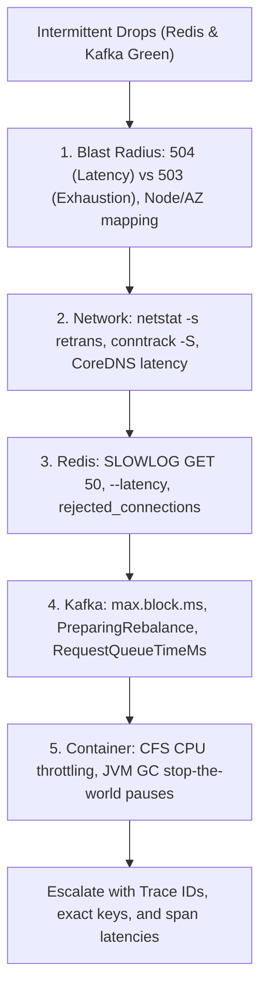
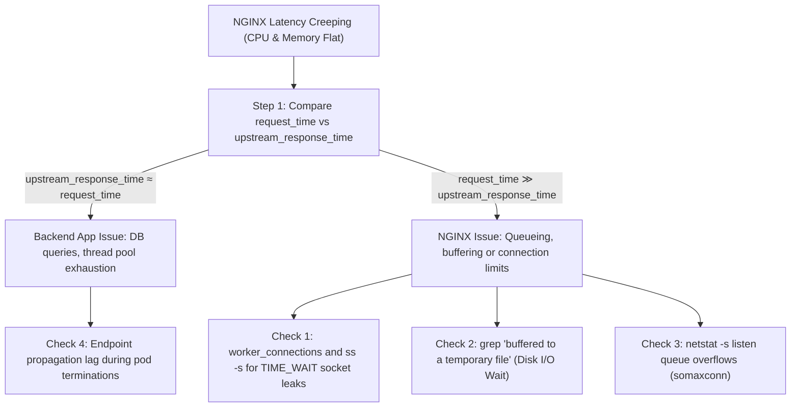

# Real-World Incident Scenarios: Kafka + Redis & NGINX Latency

## Table of Contents
- [Scenario 1: Intermittent Failures in a Kafka + Redis Stack (Both Look Green)](#scenario-1-intermittent-failures-in-a-kafka--redis-stack-both-look-green)
  - [Part 1: How to Deliver in a Real-Time Interview](#part-1-how-to-deliver-in-a-real-time-interview)
    - [The 20-Second Opening Anchor](#the-20-second-opening-anchor)
    - [Step 1: Scope the Blast Radius & Failure Signature](#step-1-scope-the-blast-radius--failure-signature)
    - [Step 2: Verify Network Transport & Socket Health](#step-2-verify-network-transport--socket-health)
    - [Step 3: Deep-Dive Redis Internals (Single-Thread Locks)](#step-3-deep-dive-redis-internals-single-thread-locks)
    - [Step 4: Deep-Dive Kafka Client & Broker Dynamics](#step-4-deep-dive-kafka-client--broker-dynamics)
    - [Step 5: Inspect Host CFS Throttling & JVM Pauses](#step-5-inspect-host-cfs-throttling--jvm-pauses)
    - [Closing Pitch: The Disciplined Developer Escalation Package](#closing-pitch-the-disciplined-developer-escalation-package)
  - [Part 2: Fast Revision Subpoints & Flowchart](#part-2-fast-revision-subpoints--flowchart)
- [Scenario 2: NGINX Ingress Latency Creep (CPU & RAM Flat)](#scenario-2-nginx-ingress-latency-creep-cpu--ram-flat)
  - [Part 1: How to Deliver in a Real-Time Interview](#part-1-how-to-deliver-in-a-real-time-interview-1)
    - [The 20-Second Opening Anchor](#the-20-second-opening-anchor-1)
    - [Step 1: Dissect NGINX Timing Metrics](#step-1-dissect-nginx-timing-metrics)
    - [Step 2: Check Connection Pool & Worker Limits](#step-2-check-connection-pool--worker-limits)
    - [Step 3: Detect Proxy Disk Buffer Spills](#step-3-detect-proxy-disk-buffer-spills)
    - [Step 4: Inspect Linux Kernel Sockets & TCP Backlog](#step-4-inspect-linux-kernel-sockets--tcp-backlog)
    - [Step 5: Check Upstream Pod Endpoints & Graceful Termination](#step-5-check-upstream-pod-endpoints--graceful-termination)
    - [Closing Pitch: The 30-Second Summary](#closing-pitch-the-30-second-summary)
  - [Part 2: Fast Revision Subpoints & Timing Flowchart](#part-2-fast-revision-subpoints--timing-flowchart)

---

## Scenario 1: Intermittent Failures in a Kafka + Redis Stack (Both Look Green)

> **Question from Interviewer:**  
> *"A production service depends on Kafka and Redis. Both datastores look completely healthy on cluster-level dashboards, yet client requests are intermittently failing. What is your triage path before escalating to application teams?"*

---

### Part 1: How to Deliver in a Real-Time Interview

#### The 20-Second Opening Anchor

> 🗣️ **What to say directly to the interviewer:**  
> *"If both Kafka and Redis appear green at the cluster level, intermittent failures almost never stem from dead instances. Instead, they point to hidden transport degradation, client-side resource starvation, or single-threaded micro-blocking.  
>  
> *Before disturbing the application teams, I follow a disciplined 5-phase triage path: scoping the failure signature, validating transport health, inspecting single-thread locks in Redis, evaluating Kafka client queue dynamics, and checking OS-level container throttling."*

##### 🎯 Choice of Words & Seniority Signals
- **Use the phrase:** *"Cluster averages hide p99 micro-blocking."*  
  *(Why: Shows you know that average CPU dashboards mask transient spikes.)*
- **Frame the sequence:** Client $\rightarrow$ Network $\rightarrow$ Engine Internals $\rightarrow$ OS Throttling.  
  *(Why: Proves you don't jump randomly between dashboards.)*

---

#### Step 1: Scope the Blast Radius & Failure Signature

> 🗣️ **How to say it:**  
> *"First, I correlate the errors at the edge ingress. Are we seeing `504 Gateway Timeout`—which indicates processing latency—or `503 Service Unavailable`, which points to pool exhaustion?  
>  
> *Then, I group the failures across our topology. Is the issue isolated to a specific Kubernetes node, an Availability Zone, or a single Redis node ID or Kafka partition leader? This immediately tells me if I am hunting a localized noisy neighbor or a global issue."*

##### ⚡ Fast Revision Subpoints:
- `504` vs `503` differentiation.
- Topology grouping: Node, AZ, or Pod level.
- Datadog/Prometheus correlation with specific partition leaders or Redis shard IDs.

---

#### Step 2: Verify Network Transport & Socket Health

> 🗣️ **How to say it:**  
> *"Next, I inspect the network transport. Intermittent failures are classic symptoms of TCP packet retransmissions or exhausted connection tracking tables."*

```bash
# Check TCP retransmissions and drops on the node
netstat -s | grep -i retrans

# Inspect Linux Conntrack table utilization (detect table saturation)
conntrack -S

# Check socket states for TIME_WAIT pileups or leaks
ss -s
```

##### 🎯 Choice of Words:
- **Mention CoreDNS:** *"I audit CoreDNS latency metrics to verify client pods aren't intermittently timing out on UDP name resolution under burst load."*
- **Mention Idle Timeouts:** *"I verify if intermediate NLB/ALB idle timeouts (e.g. AWS 350s default) are silently terminating quiet TCP connections."*

---

#### Step 3: Deep-Dive Redis Internals (Single-Thread Locks)

> 🗣️ **How to say it:**  
> *"Even if Redis shows 15% overall CPU, an unindexed or O(N) command blocks Redis's single-threaded event loop, stalling all concurrent requests for hundreds of milliseconds.  
>  
> *I run `SLOWLOG GET 50` to catch expensive commands like `KEYS *` or large `HGETALL`s. Then I run `redis-cli --latency` to check for background disk fork freezes during `BGSAVE` or memory fragmentation stalls."*

```bash
# 1. Catch queries blocking the single-threaded event loop
redis-cli -h <host> SLOWLOG GET 50

# 2. Measure live sub-millisecond engine latency spikes
redis-cli -h <host> --latency

# 3. Inspect rejected connections and memory fragmentation
redis-cli -h <host> INFO stats | grep rejected_connections
redis-cli -h <host> INFO memory | grep mem_fragmentation_ratio
```

---

#### Step 4: Deep-Dive Kafka Client & Broker Dynamics

> 🗣️ **How to say it:**  
> *"Next, I inspect Kafka client buffer dynamics. When producers intermittently fail, it's rarely the broker crashing—it's usually the client producer buffer pool filling up faster than the network can flush.  
>  
> *I search client logs for `TimeoutException: Failed to allocate memory within max.block.ms`. On the consumer side, I check broker logs for `PreparingRebalance` storms caused by slow message processing exceeding `max.poll.interval.ms`."*

```bash
# Check broker disk I/O wait and saturation
iostat -xz 1
```
- **JMX Metric to cite:** `kafka.network:type=RequestChannel,name=RequestQueueTimeMs` (shows network processor queue saturation even when CPU appears low).
- **Check:** `UnderReplicatedPartitions` (EBS volume I/O throttling delaying `acks=all`).

---

#### Step 5: Inspect Host CFS Throttling & JVM Pauses

> 🗣️ **How to say it:**  
> *"If Redis, Kafka, and the network are green, the problem is often inside the client container runtime itself.  
>  
> *If hard Kubernetes CPU limits are set, Linux Completely Fair Scheduler (CFS) throttling will freeze the pod for hundreds of milliseconds if it bursts past quota. To the outside world, this looks like a random timeout. I also inspect JVM GC pause metrics (`jvm_gc_pause_seconds_sum`) to rule out stop-the-world garbage collection freezing heartbeat threads."*

```promql
# Prometheus query for CFS CPU throttling:
rate(container_cpu_cfs_throttled_periods_total[5m])
```

---

#### Closing Pitch: The Disciplined Developer Escalation Package

> 🗣️ **How to conclude your answer:**  
> *"If all infrastructure checks pass, I escalate to the application team not with a vague complaint, but with an actionable triage package:  
> 1. Exact distributed trace IDs highlighting the stalled span (e.g., `lettuce.acquireConnection` or `KafkaProducer.send`).  
> 2. Specific error signatures (client pool exhaustion vs. serialization locks).  
> 3. Targeted Redis keys or Kafka partition numbers involved."*

---

### Part 2: Fast Revision Subpoints & Flowchart



---

## Scenario 2: NGINX Ingress Latency Creep (CPU & RAM Flat)

> **Question from Interviewer:**  
> *"You observe a gradual, steady increase in latency across an NGINX Ingress controller, but CPU and memory utilization remain flat and healthy. What is your troubleshooting methodology?"*

---

### Part 1: How to Deliver in a Real-Time Interview

#### The 20-Second Opening Anchor

> 🗣️ **What to say directly to the interviewer:**  
> *"When latency creeps up while CPU and memory remain flat, the system is **not CPU-bound or memory-bound**—it is **I/O-bound, connection-bound, or queuing upstream**.  
>  
> *My immediate priority is to isolate whether the latency is being introduced in front of NGINX, inside NGINX itself, or downstream in the application pods.  
>  
> *I do this by immediately comparing NGINX timing metrics: `request_time` versus `upstream_response_time`."*

---

#### Step 1: Dissect NGINX Timing Metrics

> 🗣️ **How to say it:**  
> *"Rather than guessing, I query NGINX timing variables from access logs or Prometheus:  
> - If `upstream_response_time` matches `request_time`, NGINX is completely fine. The latency is entirely downstream in the backend application pods (like database locks or thread starvation).  
> - If `request_time` is significantly higher than `upstream_response_time`, NGINX is causing the delay, or clients are on slow uplinks.  
> - If `upstream_connect_time` is climbing, NGINX is struggling to establish TCP handshakes with upstream backend pods."*

##### ⚡ Fast Revision Subpoints:

| Condition | Diagnostic Meaning | Action |
|:---|:---|:---|
| `upstream_response_time` ≈ `request_time` | Downstream application pod latency | Profile backend services, DB locks, thread pool |
| `request_time` ≫ `upstream_response_time` | Delay inside NGINX or slow client uploads | Inspect NGINX worker connections and disk buffers |
| High `upstream_connect_time` | TCP handshake delay to pods | Check pod SYN backlog, CNI routing, interface saturation |

---

#### Step 2: Check Connection Pool & Worker Limits

> 🗣️ **How to say it:**  
> *"If the delay is inside NGINX, I check for connection starvation. If NGINX reaches its `worker_connections` limit or OS `nofile` limit, requests queue in the socket backlog without consuming CPU.  
>  
> *Furthermore, by default NGINX opens a fresh TCP connection for every single request to upstream pods unless `upstream-keepalive-connections` is configured. Under high request rates, this causes massive TCP `TIME_WAIT` pileups and handshake latency."*

```bash
# Check open sockets on Ingress pod
ss -s

# Check logs for connection limit warnings
kubectl logs -n ingress-nginx <nginx-pod> | grep -E "worker_connections are not enough|too many open files"
```

---

#### Step 3: Detect Proxy Disk Buffer Spills

> 🗣️ **How to say it:**  
> *"Next, I check for disk buffer spills. When response bodies exceed NGINX in-memory buffers, NGINX silently buffers them to disk under `/tmp` or `/var/cache/nginx`.  
>  
> *Disk I/O blocks worker threads in kernel uninterruptible sleep (`D` state). The CPU appears completely idle, but request processing crawls. I search logs for 'response is buffered to a temporary file' and tune `proxy-buffers`."*

```bash
# Check if NGINX is writing response buffers to disk
kubectl logs -n ingress-nginx <nginx-pod> | grep "an upstream response is buffered to a temporary file"

# Check disk I/O wait on the worker node
iostat -xz 1
```

---

#### Step 4: Inspect Linux Kernel Sockets & TCP Backlog

> 🗣️ **How to say it:**  
> *"If NGINX workers are healthy, connections might be queuing in the Linux kernel queue before NGINX can accept them.  
>  
> *If incoming traffic surges, the kernel drops or delays SYNs if `somaxconn` or `tcp_max_syn_backlog` are too low. I run `netstat -s` to look for listen queue overflows."*

```bash
# Check for socket listen queue drops and overflows
netstat -s | grep -E "listen|overflowed"

# Check current OS socket backlog limit
cat /proc/sys/net/core/somaxconn
```

---

#### Step 5: Check Upstream Pod Endpoints & Graceful Termination

> 🗣️ **How to say it:**  
> *"Finally, if the latency is upstream, I verify Kubernetes endpoint synchronization. During autoscaling or rolling updates, if endpoint propagation lags, NGINX may attempt sending requests to terminating or dead pod IPs.  
>  
> *NGINX hangs waiting for `proxy_connect_timeout` before retrying the next replica, artificially inflating average response latency."*

```bash
# Check for upstream connect retries or timeouts
kubectl logs -n ingress-nginx <nginx-pod> | grep -E "upstream timed out|connect\(\) failed"
```

---

#### Closing Pitch: The 30-Second Summary

> 🗣️ **How to conclude your answer:**  
> *"In summary: when latency spikes while CPU is flat, it's queuing or I/O wait. I immediately compare `request_time` against `upstream_response_time`. If the delta is inside NGINX, I inspect upstream keep-alives, disk buffer spills, and worker connection limits. If it's at the OS level, I tune kernel `somaxconn` socket backlogs."*

---

### Part 2: Fast Revision Subpoints & Timing Flowchart


