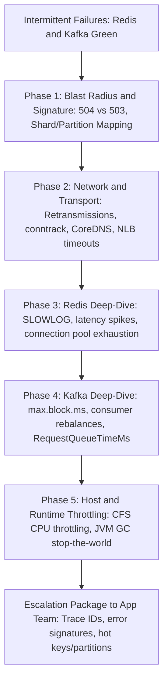
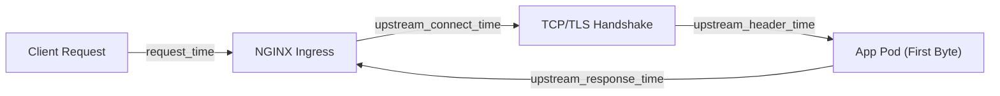

# Real-World Production Usecase Interview Questions

## Table of Contents

- [Scenario 1: Debugging Intermittent Failures in a Kafka + Redis Stack](#scenario-1-debugging-intermittent-failures-in-a-kafka--redis-stack)
  - [Triage Flowchart](#triage-flowchart)
  - [Phase 1: Scope Blast Radius & Failure Signature](#phase-1-scope-blast-radius--failure-signature)
  - [Phase 2: Verify Transport & Network Health](#phase-2-verify-transport--network-health)
  - [Phase 3: Deep-Dive Redis Internals](#phase-3-deep-dive-redis-internals)
  - [Phase 4: Deep-Dive Kafka Client & Broker Dynamics](#phase-4-deep-dive-kafka-client--broker-dynamics)
  - [Phase 5: Inspect Container Throttling & Runtime Latency](#phase-5-inspect-container-throttling--runtime-latency)
  - [The Escalation Package](#the-escalation-package)
- [Scenario 2: Diagnosing Gradual Latency Creep in NGINX Ingress (CPU & Memory Flat)](#scenario-2-diagnosing-gradual-latency-creep-in-nginx-ingress-cpu--memory-flat)
  - [Latency Timing Breakdown](#latency-timing-breakdown)
  - [Step 1: Dissect NGINX Timing Metrics](#step-1-dissect-nginx-timing-metrics)
  - [Step 2: Check Connection Pool & File Descriptor Saturation](#step-2-check-connection-pool--file-descriptor-saturation)
  - [Step 3: Check for Buffer Spills to Disk (Disk I/O Wait)](#step-3-check-for-buffer-spills-to-disk-disk-io-wait)
  - [Step 4: Inspect Linux Kernel Sockets & TCP Backlog](#step-4-inspect-linux-kernel-sockets--tcp-backlog)
  - [Step 5: Inspect Upstream Pods & Endpoint Propagation](#step-5-inspect-upstream-pods--endpoint-propagation)
  - [Summary Cheat Sheet](#summary-cheat-sheet)

---

## Scenario 1: Debugging Intermittent Failures in a Kafka + Redis Stack

> **Question:**  
> *A critical service depends on both Kafka and Redis. Both datastores appear completely green and healthy on cluster-level dashboards, yet client requests are intermittently failing. What is your systematic debug path before escalating to application teams?*

### Triage Flowchart



---

### Phase 1: Scope Blast Radius & Failure Signature

Before touching servers, categorize the failure domain:

- **Correlate Ingress Status Codes:**  
  Inspect edge proxy/mesh metrics (ALB, Envoy, Istio):
  - `504 Gateway Timeout` indicates upstream processing latency.
  - `503 Service Unavailable` points to upstream connection pool reset or exhaustion.
- **Isolate Faulty Topology:**  
  Group error metrics by Kubernetes node, Availability Zone (AZ), and container instance to rule out a degraded EC2 instance or localized noisy neighbor.
- **Map to Partitions and Shards:**  
  In Prometheus/Datadog, cross-reference error timestamps with specific Redis node IDs or Kafka partition leaders to verify if a single hot partition/shard is saturated while the cluster average appears healthy.

---

### Phase 2: Verify Transport & Network Health

Intermittent drops often hide in TCP transport degradation or connection tracking tables:

```bash
# Check for TCP packet retransmissions and drops on worker nodes
netstat -s | grep -i retrans
# Or check via Linux eBPF tools:
tcpretrans-bpfcc 1

# Inspect connection tracking table utilization (prevent drop due to full table)
conntrack -S

# Check socket states for TIME_WAIT pileups or socket exhaustion
ss -s
```

- **Audit CoreDNS Latency:** Check CoreDNS metrics and error logs for `NXDOMAIN` spikes or query timeouts caused by UDP packet drops under high burst traffic.
- **Examine Idle Timeouts & Keep-Alives:** Review intermediate load balancer logs (e.g., standard 350-second AWS NLB idle timeout terminating silent TCP connections while clients assume the connection remains open).

---

### Phase 3: Deep-Dive Redis Internals

A Redis node running at 10% CPU can still intermittently freeze if an unindexed or `O(N)` command runs on its single-threaded event loop:

```bash
# Inspect the 50 slowest queries blocking the single-threaded event loop
redis-cli -h <redis-host> -p <port> SLOWLOG GET 50

# Measure sub-millisecond engine latency spikes live
redis-cli -h <redis-host> -p <port> --latency

# Check engine internal diagnostics
redis-cli -h <redis-host> -p <port> LATENCY LATEST

# Check rejected connections, evictions, and memory fragmentation
redis-cli -h <redis-host> -p <port> INFO stats | grep -E "rejected_connections|evicted_keys"
redis-cli -h <redis-host> -p <port> INFO memory | grep -E "mem_fragmentation_ratio"
```

- **Look For:**
  - Commands like `KEYS *`, large `HGETALL`, or `SMEMBERS` locking the engine.
  - Background fork stalls during `BGSAVE` or AOF rewrite.
  - Client connection pool exhaustion (e.g., Jedis/Lettuce client active threads hitting limits and timing out waiting for a free socket).

---

### Phase 4: Deep-Dive Kafka Client & Broker Dynamics

Cluster dashboards show green when broker nodes are operational, but client producer/consumer buffers may be stalling:

```bash
# Inspect broker disk I/O wait and saturation
iostat -xz 1
```

- **Client Buffer Timeouts:**  
  Search application logs for:
  - `TimeoutException: Failed to allocate memory within max.block.ms`
  - `Expiring 1 record(s) batches due to timeout`  
  *Cause:* Producer memory buffer pool (`buffer.memory`) is saturated because batch flushes cannot keep pace with ingestion.
- **Consumer Group Rebalances:**  
  Check Kafka group coordinator logs for `PreparingRebalance`. If message processing in downstream worker threads exceeds `max.poll.interval.ms`, the consumer is evicted and triggers repeated rebalancing storms.
- **Broker Network Queue Latency (JMX):**  
  Monitor broker JMX metrics:
  - `kafka.network:type=RequestChannel,name=RequestQueueTimeMs`
  - `kafka.server:type=KafkaApis,name=LocalTimeMs`  
  A spike in `RequestQueueTimeMs` confirms network processor threads are saturated even if broker CPU appears low.
- **Replication Lag:** Check `UnderReplicatedPartitions`. A slow EBS disk or slow broker replica delays producer `acks=all` requests.

---

### Phase 5: Inspect Container Throttling & Runtime Latency

Often the databases are completely fine, but the client application container is intermittently frozen by the OS or language runtime:

- **Linux CFS CPU Throttling:**  
  Query Prometheus:
  ```promql
  rate(container_cpu_cfs_throttled_periods_total[5m])
  ```
  If hard CPU limits (`resources.limits.cpu`) are enforced, the Linux kernel completely freezes pod processes for several hundred milliseconds upon exceeding quota, dropping active TCP sockets.
- **JVM / Go Garbage Collection Pauses:**  
  Check runtime metrics (`jvm_gc_pause_seconds_sum`). Stop-the-world GC pauses pause heartbeat threads, causing Redis/Kafka client timeouts.

---

### The Escalation Package

If all platform, network, and infrastructure layers are verified clean, escalate to developers with a precise diagnosis rather than a generic ticket:

1. **Exact Distributed Trace IDs:** Highlight the precise span where the call halted (e.g., `lettuce.acquireConnection` or `KafkaProducer.send`).
2. **Specific Error Signatures:** Differentiate between client pool starvation, serialization locks, or retry storms.
3. **Targeted Partitions and Keys:** Pinpoint the exact Redis keys or Kafka partitions under contention.

---

## Scenario 2: Diagnosing Gradual Latency Creep in NGINX Ingress (CPU & Memory Flat)

> **Question:**  
> *You observe a gradual, steady increase in latency across an NGINX Ingress controller, but CPU and memory utilization remain flat and healthy. What is your troubleshooting methodology?*

### Latency Timing Breakdown

When CPU and memory remain flat while latency increases, the system is **not CPU-bound or memory-bound**—it is **I/O-bound, connection-bound, or queuing upstream**.



---

### Step 1: Dissect NGINX Timing Metrics

Inspect NGINX access log variables or Prometheus metrics (`nginx_ingress_controller_request_duration_seconds`):

| Metric Condition | Root Cause Diagnosis | Action |
|:---|:---|:---|
| `upstream_response_time` ≈ `request_time` | **Downstream app bottleneck:** NGINX is healthy; backend application pods are taking too long to process requests (DB locks, slow external APIs, thread pool starvation). | Profile application pods, DB queries, and downstream microservices. |
| `request_time` ≫ `upstream_response_time` | **NGINX / Proxy bottleneck:** The latency occurs inside NGINX itself or between client and NGINX (buffering, socket queue delay). | Investigate client payload upload speeds, disk buffer spills, and connection limits. |
| Elevated `upstream_connect_time` | **Upstream TCP handshake bottleneck:** NGINX is struggling to establish TCP connections with backend pods. | Check network interface saturation, pod SYN backlog, and CNI routing tables. |
| Elevated `upstream_header_time` | **Backend processing lag:** Backend pod accepted the connection but delayed generating response headers. | Check application event loop or worker thread saturation. |

---

### Step 2: Check Connection Pool & File Descriptor Saturation

If NGINX introduces latency without consuming CPU, worker connections or file descriptors are likely saturated:

```bash
# 1. Check open sockets and connection states on the NGINX pod
ss -s

# 2. Check for worker connection and open file descriptor limit exhaustion
kubectl logs -n ingress-nginx <nginx-ingress-pod-name> | grep -E "worker_connections are not enough|too many open files"
```

- **Upstream Keep-Alive Disabled (TCP Handshake Overhead):**  
  By default, unless configured via annotations (`upstream-keepalive-connections`), NGINX opens and closes a new TCP connection (and full TLS handshake) for every single backend request. Under load, this leads to massive TCP `TIME_WAIT` socket buildup and latency delays.  
  *Fix:* Enable upstream keep-alive connections in the Ingress ConfigMap:
  ```yaml
  apiVersion: v1
  kind: ConfigMap
  metadata:
    name: ingress-nginx-controller
    namespace: ingress-nginx
  data:
    upstream-keepalive-connections: "100"
    upstream-keepalive-timeout: "60"
    upstream-keepalive-requests: "10000"
  ```

---

### Step 3: Check for Buffer Spills to Disk (Disk I/O Wait)

When request payloads or upstream responses exceed NGINX in-memory buffer capacities, NGINX buffers content to local disk (`/tmp` or `/var/cache/nginx`).

- **Why CPU Stays Low:** Disk I/O blocks worker threads in kernel **uninterruptible sleep** (`D` state). The CPU appears idle, yet requests crawl.

```bash
# Search logs for proxy buffer disk spills
kubectl logs -n ingress-nginx <nginx-ingress-pod-name> | grep "an upstream response is buffered to a temporary file"

# Check disk I/O metrics on the ingress worker node
iostat -xz 1
```

*Remediation:* Increase memory buffer sizes in the Ingress configuration:
- `proxy-buffer-size: "16k"`
- `proxy-buffers-number: "8"`
- `client-body-buffer-size: "128k"`

---

### Step 4: Inspect Linux Kernel Sockets & TCP Backlog

Incoming connection requests may be queuing in the kernel backlog before NGINX worker processes can accept them:

```bash
# Check socket listen drops and TCP backlog overflow counters
netstat -s | grep -E "listen|overflowed"

# Check the current OS socket listen backlog ceiling
cat /proc/sys/net/core/somaxconn

# Check Linux Conntrack connection limits
cat /proc/sys/net/netfilter/nf_conntrack_count
cat /proc/sys/net/netfilter/nf_conntrack_max
```

*Remediation:* Tune node-level kernel network settings:
```bash
sysctl -w net.core.somaxconn=65535
sysctl -w net.ipv4.tcp_max_syn_backlog=65535
```

---

### Step 5: Inspect Upstream Pods & Endpoint Propagation

If `upstream_response_time` is elevated:

- **Uneven Load Distribution:**  
  Check whether traffic is disproportionately hitting a single hot pod due to sticky session hashing or stale DNS caches.
- **TCP Retries to Terminating Pods:**  
  When upstream pods scale down or crash, if Kubernetes endpoint propagation lags behind, NGINX attempts sending requests to terminating IPs, stalling until `proxy_connect_timeout` expires before failing over.

```bash
# Verify if NGINX is failing over or timing out during upstream connects
kubectl logs -n ingress-nginx <nginx-ingress-pod-name> | grep -E "upstream timed out|connect\(\) failed"
```

---

### Summary Cheat Sheet

> [!TIP]
> **Key Takeaway for an Interview:**  
> When CPU and memory are flat but latency spikes:
> 1. Compare `request_time` with `upstream_response_time` to locate the bottleneck (proxy vs backend).
> 2. If inside NGINX: check **upstream keep-alives**, **worker connection limits**, and **temporary file disk buffer spills**.
> 3. If at the OS level: check **`somaxconn` socket backlog drops** and **`conntrack` table limits**.
