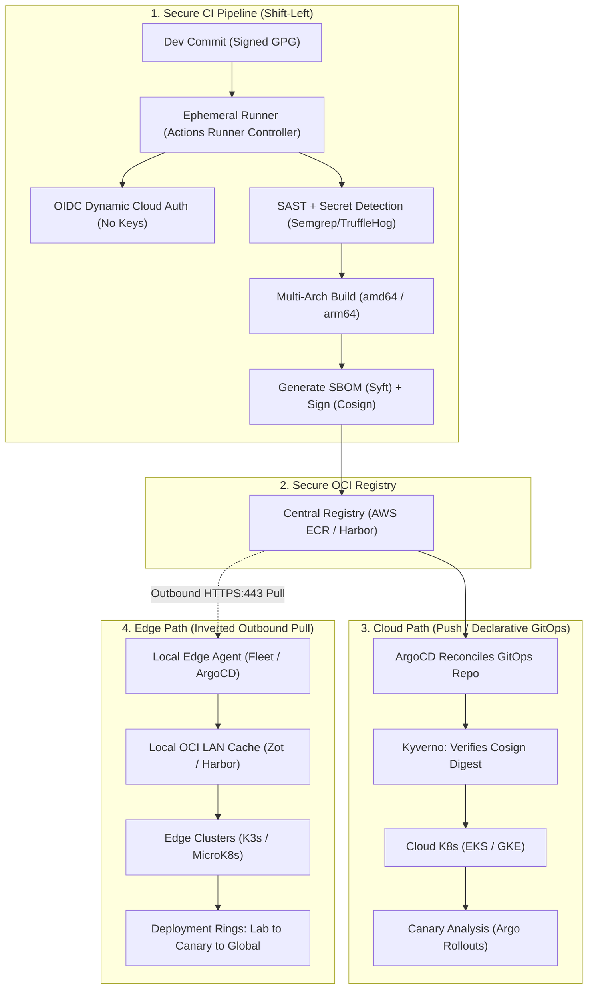

# System Design: Secure Hybrid CI/CD Pipeline (Cloud + Edge)

> **Question from Interviewer:**  
> *"Walk me through how you’d design a secure CI/CD pipeline that pushes code to both cloud and on-prem edge environments."*

---

## Part 1: How to Portray & Deliver in a Real-Time Interview

### The 30-Second Opening Anchor (The "Architectural Axiom")

> 🗣️ **What to say directly to the interviewer:**  
> *"When designing a CI/CD pipeline spanning both cloud and on-prem edge environments, the primary architectural challenge isn't compiling or containerizing code—it's bridging network and security trust boundaries.  
>  
> *Cloud environments like AWS or GCP are API-driven and dynamically addressable. But on-prem edge sites—such as factories, micro-datacenters, or retail nodes—sit behind strict corporate firewalls, NATs, and variable uplinks.  
>  
> *My core architectural philosophy is: **'Push to Cloud, Pull to Edge'**. We must never punch inbound firewall holes into edge facilities or store long-lived cloud credentials on edge devices.  
>  
> *I structure this end-to-end architecture across five sequential layers: pipeline identity, supply chain security, cloud GitOps, edge pull agents, and phased fleet rollbacks."*

#### 🎯 Choice of Words & Seniority Signals
- **Use the phrase:** *"Push to Cloud, Pull to Edge."*  
  *(Why: Instantly frames you as a systems architect who understands enterprise network boundaries, not just generic Jenkins scripts.)*
- **Emphasize:** *"Inversion of control"* and *"Zero inbound ports."*  
  *(Why: Signals that you understand industrial edge security principles.)*
- **Avoid:** Saying you will SSH or run `kubectl apply` directly against edge nodes from GitHub Actions.

---

### Step 1: Pipeline Identity & Runner Trust (Zero Static Secrets)

> 🗣️ **How to say it:**  
> *"Starting at the source, I enforce zero long-lived credentials. Our CI runners authenticate to cloud IAM using OpenID Connect (OIDC) to assume short-lived, least-privilege roles, eliminating static API keys entirely.  
>  
> *Furthermore, builds run on disposable, ephemeral runners—such as Kubernetes-based Actions Runner Controller—that terminate immediately after job completion to prevent cross-build credential leaking."*

#### ⚡ Fast Revision Subpoints:
- **OIDC Identity:** Replace `AWS_ACCESS_KEY_ID` with dynamic GitHub Actions OIDC federation (`sts:AssumeRoleWithWebIdentity`).
- **Ephemeral Runners:** Actions Runner Controller (ARC) spawns disposable pods per PR.
- **Commit Signing:** Mandatory GPG/SSH signed commits and branch protection on `main`.

---

### Step 2: Build & Supply Chain Security (Shift-Left & SLSA)

> 🗣️ **How to say it:**  
> *"Next is supply chain integrity. We shift security left by running SAST and pre-commit secret scanners on every PR. Before pushing images, we generate multi-arch builds for amd64 cloud servers and arm64/amd64 edge nodes.  
>  
> *Crucially, we generate a Software Bill of Materials (SBOM) using Syft and cryptographically sign the container digest using Cosign. The signature and SBOM are published alongside the image in our central OCI registry."*

#### ⚡ Fast Revision Subpoints & Commands:
```bash
# Generate SBOM with Syft
syft packages <image> -o spdx-json > sbom.json

# Keyless signing via Cosign & OIDC
cosign sign --yes <registry>/<image>@sha256:<digest>
cosign attest --yes --predicate sbom.json --type spdx <registry>/<image>@sha256:<digest>
```
- **Tools:** SAST (Semgrep/SonarQube), Secrets (TruffleHog), SCA/CVE (Trivy), Signing (Cosign).

---

### Step 3: Cloud Target Delivery (Declarative GitOps & Progressive Canary)

> 🗣️ **How to say it:**  
> *"For cloud targets, CI never touches clusters directly with `kubectl`. Instead, the pipeline commits updated image tags to a dedicated GitOps repository.  
>  
> *ArgoCD reconciles the cluster state declaratively. We use Argo Rollouts or Flagger for automated canary delivery, shifting traffic from 5% to 100% based on Prometheus error rates and latencies. In-cluster admission controllers like Kyverno enforce that only Cosign-signed images can ever be scheduled."*

#### ⚡ Fast Revision Subpoints:
- **GitOps Engine:** ArgoCD or Flux (pulls from config repo).
- **Canary Engine:** Argo Rollouts or Flagger (automated rollback if HTTP 5xx spikes).
- **Admission Control:** Kyverno / OPA Gatekeeper (verifies Cosign cryptographic signatures).

---

### Step 4: Edge Target Delivery (Inverted Outbound Pull & Local Mirrors)

> 🗣️ **How to say it:**  
> *"For on-prem edge targets, we invert the control plane. We never open inbound ports like SSH port 22 or K8s port 6443 into edge locations.  
>  
> *Instead, a lightweight GitOps agent—like Rancher Fleet, ArgoCD, or balena running inside a local K3s cluster—periodically makes outbound HTTPS calls over port 443 to pull manifests.  
>  
> *To protect local bandwidth during large deployments, we deploy an on-prem pull-through cache like Harbor or Zot. Edge nodes fetch container layers over the local LAN. If the external internet drops, edge workloads operate autonomously in offline mode."*

#### ⚡ Fast Revision Subpoints:
- **Outbound-Only:** HTTPS (port 443) or WebSocket connections initiated by edge agent.
- **Local OCI Cache:** Zot or Harbor edge mirror (saves satellite/WAN bandwidth).
- **Offline Tolerance:** Local K3s runtime continues executing without cloud connectivity.

---

### Step 5: Rollback Strategy & Phased Fleet Rings (The Wrap-Up Pitch)

> 🗣️ **How to conclude your answer:**  
> *"Finally, we enforce safety across the edge fleet using Phased Deployment Rings:  
> 1. Ring 0: Internal hardware-in-the-loop (HIL) lab.  
> 2. Ring 1: Single canary factory or retail site.  
> 3. Ring 2: Regional rollout.  
> 4. Ring 3: 100% global fleet.  
>  
> *Aggressive readiness and liveness probes trigger automated local rollbacks to the prior container image if a crash loop occurs, while telemetry streams back asynchronously via Kafka or MQTT to a central Grafana/Datadog dashboard."*

---

## Part 2: Quick Revision Subpoints & Visual Diagrams

### 1-Minute Visual Architecture Flowchart



---

### Cloud vs. On-Prem Edge: Mental Model Matrix

| Dimension | Cloud Target | On-Prem Edge Target |
|:---|:---|:---|
| **Firewall / Network** | Inbound VPC / PrivateLink allowed | **Strictly Outbound-only** (HTTPS 443 / WebSocket) |
| **Control Model** | Declarative GitOps reconciliation | **Inverted Pull Model** via local agent (K3s / Fleet) |
| **Network Latency** | High-speed cloud backbone | Constrained WAN; requires **local LAN OCI caching** |
| **Deployment Model** | Canary / Blue-Green (Argo Rollouts) | **Phased Rings** (Lab $\rightarrow$ Canary Site $\rightarrow$ Global) |
| **Offline Tolerance** | Handled via Multi-AZ/Multi-Region | **Mandatory offline mode** with local data buffers |
