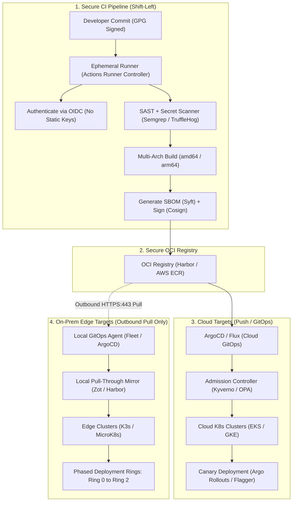

# System Design Interview Questions

---

## Scenario: Secure Hybrid CI/CD Pipeline (Cloud + On-Prem Edge)

> **Question:**  
> *Walk me through how you’d design a secure CI/CD pipeline that pushes code to both cloud and on-prem edge environments.*

---

### Core Architectural Philosophy

> [!IMPORTANT]
> **Core Principle: "Push to Cloud, Pull to Edge"**  
> On-prem edge environments sit behind strict industrial firewalls, NATs, and potentially air-gapped zones. Never punch inbound firewall holes or store long-lived cloud credentials on edge nodes. The cloud accepts declarative GitOps synchronization; edge nodes pull via outbound-only HTTPS polling.

---

### End-to-End Pipeline Architecture



---

### The 5 Architectural Layers

### Layer 1: Source & Pipeline Identity (Zero Long-Lived Secrets)

- **Short-Lived OIDC Authentication:**  
  Eliminate static cloud credentials (`AWS_ACCESS_KEY_ID`, `AWS_SECRET_ACCESS_KEY`). Configure GitHub Actions or GitLab CI to authenticate with cloud IAM using **OpenID Connect (OIDC)** to assume short-lived, least-privilege deployment roles.
- **Ephemeral Build Runners:**  
  Execute pipeline jobs inside isolated, disposable containers (e.g., Kubernetes-based **Actions Runner Controller**). Runners terminate immediately upon job completion to prevent cross-build credential leaking or artifact pollution.
- **Branch Protections & Signed Commits:**  
  Enforce mandatory branch protection rules requiring cryptographically signed **GPG commits**, branch-protection rules, and mandatory peer approvals prior to merging to `main`.

---

### Layer 2: Build & Supply Chain Security (Shift-Left & SLSA Compliance)

- **Static Analysis & Secret Detection:**  
  Run SAST (SonarQube, Semgrep) and pre-commit secret scanners (TruffleHog, Gitleaks) on every pull request, failing builds on critical findings before code merges.
- **Dependency & Container Vulnerability Audits:**  
  Audit software composition (SCA) using tools like Snyk or OWASP Dependency-Check. Scan base container images using Trivy or Grype before pushing.
- **Artifact Signing & SBOM Generation:**  
  - Compile **multi-architecture container images** (`linux/amd64` for cloud servers, `linux/arm64` or `amd64` for edge devices).
  - Generate a **Software Bill of Materials (SBOM)** via `Syft`.
  - Cryptographically sign image digests using `Cosign` (Sigstore) and push signatures to an OCI-compliant registry (e.g., AWS ECR or Harbor).

```bash
# Example: Generating SBOM and signing with Cosign & Keyless OIDC
syft packages alpine:latest -o spdx-json > sbom.json
cosign sign --yes <registry>/<image>@sha256:<digest>
cosign attest --yes --predicate sbom.json --type spdx <registry>/<image>@sha256:<digest>
```

---

### Layer 3: Cloud Deployment (Declarative GitOps & Progressive Rollouts)

- **Declarative Continuous Delivery via ArgoCD / Flux:**  
  Avoid giving CI runners direct `kubectl` access or cluster credentials. The CI runner merely updates the target image digest in a dedicated configuration repository. ArgoCD or Flux detects the Git commit and reconciles cluster state.
- **Automated Progressive Delivery:**  
  Use **Argo Rollouts** or **Flagger** to perform canary or blue/green releases. Monitor Prometheus error rates and HTTP response latencies before advancing traffic from 5% to 100%.
- **Admission Control Enforcement:**  
  Deploy **Kyverno** or **OPA Gatekeeper** to reject any pod deployment whose image has not been cryptographically verified by Cosign against the enterprise root of trust.

---

### Layer 4: On-Prem Edge Deployment (Pull-Based GitOps & Local Proxies)

- **Outbound-Only Inversion of Control (Pull Model):**  
  - **Zero Inbound Firewall Ports:** Never expose port `22` (SSH) or `6443` (Kubernetes API) to the internet at edge sites.
  - Run a lightweight GitOps agent (e.g., ArgoCD, Flux, Rancher Fleet, or balena) directly inside local edge clusters (K3s or MicroK8s).
  - The local agent initiates outbound HTTPS (port `443`) polling or uses secure WebSocket connections to reconcile manifests.
- **Local Caching / OCI Edge Mirrors:**  
  Deploy a lightweight pull-through OCI cache (e.g., **Zot** or **Harbor**) on the factory/edge LAN. Edge nodes fetch heavy layers locally over the local LAN, preventing bandwidth saturation of satellite or cellular uplinks.
- **Air-Gapped & Resilient Fallback:**  
  If the WAN/internet link drops, running edge workloads continue operating uninterrupted, caching local sensor/telemetry buffers locally until upstream connectivity recovers.

---

### Layer 5: Automated Rollback, Staging & Observability

- **Automated Health Probing & Immediate Rollback:**  
  Configure aggressive startup, readiness, and liveness probes. If the new binary crashes or fails health checks on an edge node, the local orchestrator immediately rolls back to the previous stable container image without manual intervention.
- **Phased Fleet Staging (Ring Deployments):**  
  Deploy updates to edge devices progressively across deployment rings:
  - **Ring 0:** Internal hardware-in-the-loop (HIL) lab clusters.
  - **Ring 1:** Single canary factory or edge facility.
  - **Ring 2:** Regional rollout.
  - **Ring 3:** 100% global fleet.
- **Unified Telemetry & Audit Logs:**  
  Pipe edge logs and OpenTelemetry metrics back to centralized monitoring (Datadog, Grafana, CloudWatch) asynchronously via **Kafka** or **MQTT brokers**, ensuring visibility without blocking runtime threads.

---

### Cloud vs. On-Prem Edge: Architectural Comparison

| Dimension | Cloud Deployment | On-Prem Edge Deployment |
|:---|:---|:---|
| **Network Model** | Inbound API access allowed (VPC / PrivateLink) | **Strictly Outbound-only** (HTTPS / 443 / WebSocket) |
| **Control Model** | Declarative Push or GitOps sync | **Inverted Pull Model** via local agent (K3s / Fleet) |
| **Bandwidth & Latency** | High-speed backbone, negligible pull time | Constrained uplinks; requires **local LAN OCI caching** |
| **Rollout Strategy** | Canary / Blue-Green (Argo Rollouts) | **Phased Rings** (Lab → Canary Site → Global) |
| **Disconnection Behavior** | Rare; handled via Multi-AZ/Multi-Region | Common; **Autonomous offline mode** with local data queue |
| **Image Verification** | In-cluster Admission Controller (Kyverno/OPA) | Pre-execution cryptographic digest check on host |

---

### Interview Delivery Summary

> [!TIP]
> **How to summarize this answer in 60 seconds:**
> 1. **Core Philosophy:** Explain "Push to Cloud, Pull to Edge" to solve the firewall/trust-boundary challenge.
> 2. **Identity & Security:** Mention OIDC for passwordless CI and Cosign + SBOM for SLSA supply chain security.
> 3. **Cloud Strategy:** Mention GitOps (ArgoCD) with progressive canary rollouts (Flagger/Argo Rollouts) and Kyverno admission controls.
> 4. **Edge Strategy:** Explain the outbound-only agent model (K3s + Fleet), local OCI pull-through cache (Zot/Harbor), and ring-based deployments to protect physical operations.
